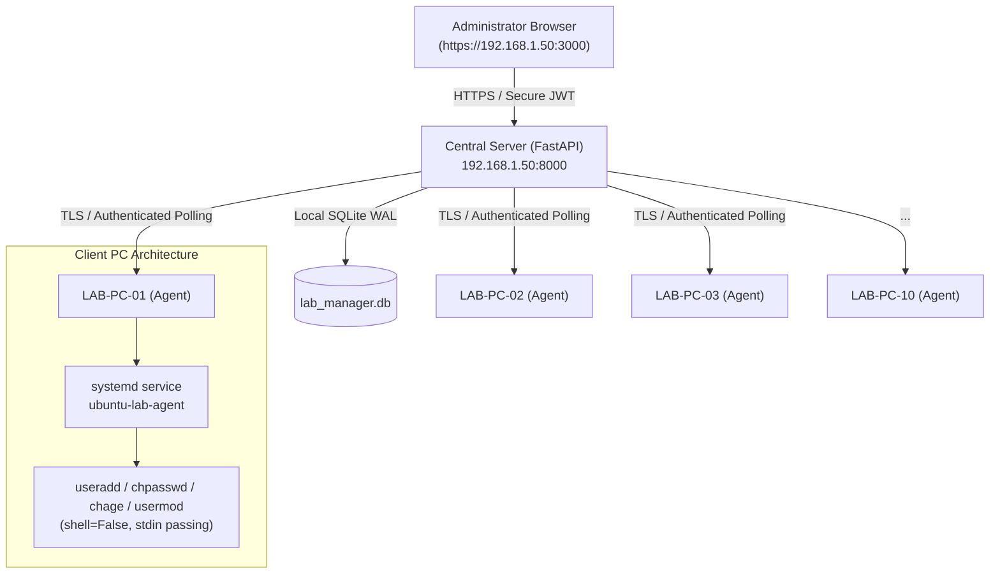

# Ubuntu Lab Manager — Architecture & LAN Design

## Overview
**Ubuntu Lab Manager** is a dedicated, zero-cloud, LAN-only centralized administrative dashboard and agent system designed to manage Linux user accounts across 10 Ubuntu PCs (e.g., `LAB-PC-01` to `LAB-PC-10`) connected to the same local area network.

---

## Key Components

### 1. Central Server (`backend/`)
- **FastAPI Application**: High-performance asynchronous REST API.
- **SQLite with WAL Mode**: Write-Ahead Logging allows simultaneous reads and writes without lock contention.
- **Background Worker**: In-process background loop checking heartbeat timeouts (marking stale devices offline after 45s), reconciling batch statuses, and cleaning expired credential envelopes.
- **Argon2id Password Hashing**: State-of-the-art memory-hard hashing for administrator logins.

### 2. Client Agent (`agent/`)
- **Zero Third-Party Dependencies**: Built exclusively with Python standard library (`urllib.request`, `ssl`, `json`, `subprocess`). Does not require `pip` or virtualenvs on the Ubuntu PCs.
- **Independent Device Identity**: Authenticates using a high-entropy device token generated upon one-time enrollment.
- **Continuous Heartbeat**: Reports LAN IP, hostname, MAC address, OS version, kernel version, uptime, and system load every 15 seconds.
- **Systemd Integration**: Managed as a native `systemd` daemon (`ubuntu-lab-agent.service`) with auto-restart on network or service glitch.

### 3. Ephemeral Credential Envelopes
To satisfy the strict requirement that passwords must never be stored in plaintext in the database or logged in audit trails:
1. When a user account creation or password reset is queued, the credential is encrypted using **AES-256-GCM** with a derived application key.
2. The encrypted envelope has a short-lived TTL (10 minutes).
3. When the assigned Ubuntu PC polls for its next task, the credential is decrypted in-flight and transmitted over TLS.
4. **Immediate Wiping**: The moment the agent polls the task, the credential envelope is permanently erased from the SQLite database.
5. On the PC, the password is piped directly into `/usr/sbin/chpasswd` via `stdin`—never passed via command-line arguments (`argv`), never written to disk, and never output to syslog.

### 4. Protected Accounts Safelist
The application includes a strict built-in blacklist of system and administrative accounts:
`root`, `ubuntu`, `admin`, `administrator`, `sudo`, `sys`, `daemon`, `bin`, `sync`, `games`, `man`, `lp`, `mail`, `news`, `uucp`, `proxy`, `www-data`, `backup`, `list`, `irc`, `gnats`, `nobody`, `systemd-*`, `sshd`.
Any attempt to create, lock, unlock, reset password, or delete any of these accounts is rejected both at the API layer and locally inside the agent executor.

### 5. LAN-Only Security
- Operates entirely offline without requiring internet access.
- HTTPS TLS certificates with Subject Alternative Names (SAN) for all LAN IPs and hostnames.
